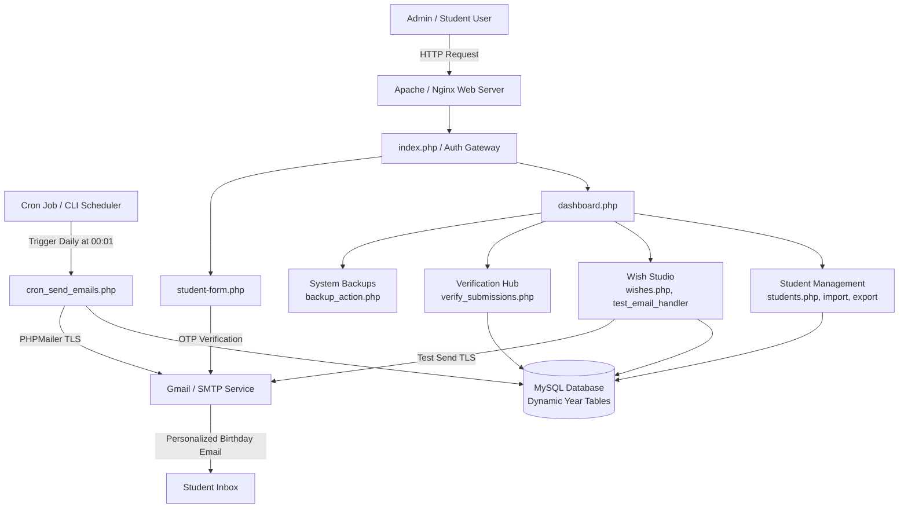
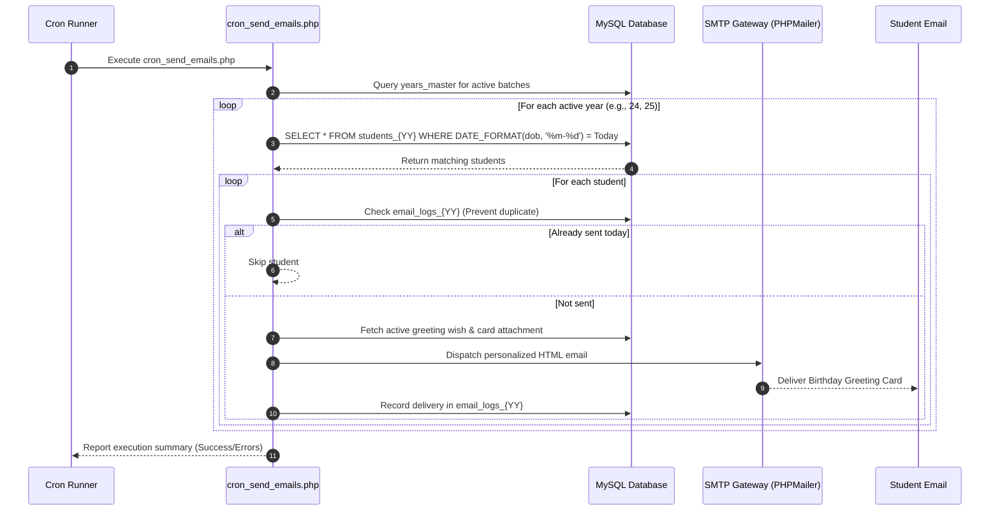
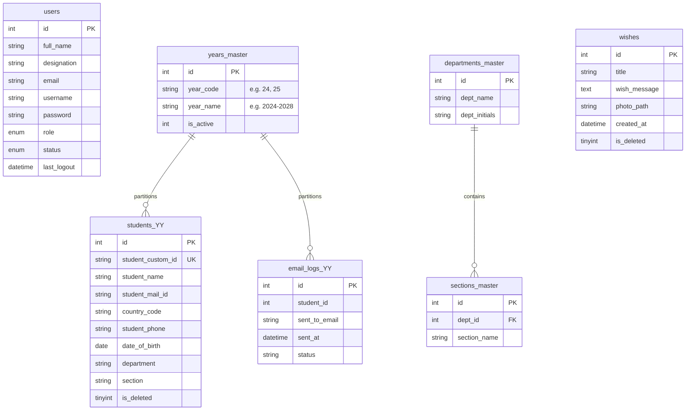

<h1 align="center">🎂 Birthday Wish Automation & Student Portal</h1>

<p align="center">
  <strong>An Enterprise-Grade, Automated Birthday Greeting Dispatcher & Dynamic Multi-Batch Student Information Management System</strong>
</p>

<p align="center">
  <a href="#-key-features"></a>
  <a href="#-database-architecture"></a>
  <a href="#-smtp--api-credentials-setup"></a>
  <a href="#-key-features"></a>
  <a href="#-cron-automation-engine"></a>
  <a href="#-license"></a>
</p>

<p align="center">
  <a href="#-quick-links">Quick Links</a> •
  <a href="#-system-architecture">Architecture</a> •
  <a href="#-key-features">Key Features</a> •
  <a href="#-installation--setup">Installation</a> •
  <a href="#-smtp--api-credentials-setup">SMTP & API Setup</a> •
  <a href="#-cron-automation-engine">Cron Automation</a> •
  <a href="#-file-structure">File Structure</a>
</p>

---

## 📌 Overview

**Birthday Wish Automation & Student Portal** is a production-ready, institutional-grade web application built to automate the celebration of student birthdays while providing an end-to-end student lifecycle and batch record management system. 

The application automatically scans database records daily for students celebrating birthdays, generates rich HTML email cards with personalized greetings and dynamic card attachments, and dispatches them via secure SMTP. In addition, the platform features a responsive administration dashboard, multi-year batch partitioning, self-service student onboarding with OTP verification, bulk CSV data tools, and soft-delete trash controls.

> [!IMPORTANT]
> **Security Notice**: All sample API keys and SMTP credentials in this repository have been replaced with placeholders (`USE_YOUR_OWN_API_KEY` and `USE_YOUR_OWN_EMAIL@gmail.com`). Follow the [SMTP & API Credentials Setup](#-smtp--api-credentials-setup) instructions below before launching the application.

---

## 🎯 Quick Links & Interactive Navigator

<details open>
<summary><b>📑 Table of Contents (Click to collapse / expand)</b></summary>

- [🎂 Birthday Wish Automation & Student Portal](#-birthday-wish-automation--student-portal)
  - [📌 Overview](#-overview)
  - [🎯 Quick Links & Interactive Navigator](#-quick-links--interactive-navigator)
  - [✨ Key Features](#-key-features)
  - [🏗️ System Architecture](#️-system-architecture)
    - [Architecture Diagram](#architecture-diagram)
    - [Automated Dispatch Sequence](#automated-dispatch-sequence)
  - [🚀 Installation & Setup](#-installation--setup)
    - [Prerequisites](#prerequisites)
    - [Step 1: Clone Repository](#step-1-clone-repository)
    - [Step 2: Database Configuration](#step-2-database-configuration)
    - [Step 3: Web Server / Virtual Host Setup](#step-3-web-server--virtual-host-setup)
  - [🔑 SMTP & API Credentials Setup](#-smtp--api-credentials-setup)
    - [How to Generate a Google App Password](#how-to-generate-a-google-app-password)
    - [Where to Update API & Credentials](#where-to-update-api--credentials)
  - [⏰ Cron Automation Engine](#-cron-automation-engine)
    - [CLI Execution (Server Crontab)](#cli-execution-server-crontab)
    - [Webhook / HTTP Web Cron](#webhook--http-web-cron)
    - [External Cloud Cron Setup](#external-cloud-cron-setup)
  - [🗄️ Database Architecture](#️-database-architecture)
    - [Entity Relationship Diagram](#entity-relationship-diagram)
    - [Dynamic Year-Wise Table Sharding](#dynamic-year-wise-table-sharding)
  - [🧪 Testing & Simulation Sandbox](#-testing--simulation-sandbox)
  - [📂 File Structure](#-file-structure)
  - [🛡️ Security & Best Practices](#️-security--best-practices)
  - [🤝 Contributing](#-contributing)
  - [📜 License](#-license)

</details>

---

## ✨ Key Features

### 🍰 Autonomous Daily Birthday Greeter
- **Hands-Free Daily Execution**: Automated cron script (`cron_send_emails.php`) checks for student birthdays matching the current month and day (`MM-DD`).
- **Dynamic Year Sharding**: Automatically cycles through all configured academic batches (e.g., `students_24`, `students_25`).
- **Personalized Template Engine**: Randomizes or assigns customized greeting cards (`uploads/content_*.png`) with heartfelt wishes.
- **Robust Delivery Logging**: Maintains delivery audit logs in year-specific tables (`email_logs_24`, `email_logs_25`) to prevent duplicate dispatches.

### 📊 Modern Administrative Dashboard
- **KPI Metrics at a Glance**: Total registered students, active batches, wishes dispatched today, and pending verifications.
- **Real-Time System Health**: Built-in monitor (`system_status.php`) checking database connectivity, SMTP latency, disk space, and directory permissions.
- **Batch Selector**: Effortlessly switch views across admission years and departments.

### 👥 Student Directory & Lifecycle Management
- **Single & Bulk Creation**: Add individual records or bulk import rosters via formatted CSV files.
- **Live Student ID Validation**: Asynchronous AJAX checks (`check_student_id.php`) prevent duplicate enrolments.
- **Recycle Bin (Trash System)**: Soft-deletion architecture (`trash_students.php`, `trash_action.php`) allows safe recovery of mistakenly deleted records.
- **Internationalization**: Full dial-code support across 200+ countries (`countries.php`).

### 📝 Self-Service Student Onboarding
- **Public Registration Portal**: QR-friendly form (`student-form.php`) allowing students to submit their official details.
- **OTP Verification Flow**: One-time passcodes sent via email (`otp_handler.php`) to eliminate bots and unverified emails.
- **Admin Verification Queue**: Dedicated review portal (`verify_submissions.php`) with an optional auto-accept toggle.

### 🎨 Wishes & Greetings Studio
- **Custom Artwork Management**: Upload, preview, and organize greeting card graphic designs.
- **Live Test-Send Sandbox**: Built-in test harness (`test_email_handler.php`) to preview cards and test delivery to admin emails before production runs.

### 🔐 Enterprise Multi-Admin Security
- **Multi-Role Accounts**: Granular administrative designations and privileges.
- **Two-Factor Admin Actions**: High-privilege tasks (such as onboarding new administrators) require an email OTP verification code.
- **Integrated Database Backups**: 1-click full SQL snapshots and CSV exports stored under `backups/`.

---

## 🏗️ System Architecture

### Architecture Diagram



### Automated Dispatch Sequence



---

## 🚀 Installation & Setup

### Prerequisites
- **Web Server**: Apache 2.4+ (with `mod_rewrite` enabled) or Nginx
- **PHP**: Version 7.4, 8.0, 8.1, or 8.2+
  - Required Extensions: `mysqli`, `openssl`, `mbstring`, `json`, `curl`
- **Database**: MySQL 5.7+ or MariaDB 10.4+
- **Mail Server**: Any standard SMTP provider (Gmail, Brevo, SendGrid, Amazon SES, or custom mail server)

---

### Step 1: Clone Repository

```bash
# Clone the repository to your local web root
git clone https://github.com/your-username/birthday-automation.git

# Move into project directory
cd birthday-automation
```

---

### Step 2: Database Configuration

1. Open your database administration tool (**phpMyAdmin**, **MySQL Workbench**, or CLI).
2. Create a new database:
   ```sql
   CREATE DATABASE birthday_db CHARACTER SET utf8mb4 COLLATE utf8mb4_general_ci;
   ```
3. Import the initial database schema and master seed data:
   ```bash
   mysql -u root -p birthday_db < if0_40768646_birthday_wish_automation.sql
   ```
4. Configure database credentials in [`config.php`](file:///d:/00.My%20Projects/CV%20Projects/birthday/config.php):
   ```php
   // config.php
   define('DB_SERVER', 'localhost');
   define('DB_USERNAME', 'root');     // Your database user
   define('DB_PASSWORD', '');         // Your database password
   define('DB_NAME', 'birthday_db');  // Your database name
   ```

---

### Step 3: Web Server / Virtual Host Setup

If running locally via **XAMPP / WampServer**:
- Place this directory inside `htdocs/birthday/` or `www/birthday/`.
- Ensure write permissions on `uploads/` and `backups/`:
  ```bash
  chmod -R 775 uploads backups
  ```
- Navigate to `http://localhost/birthday/` in your web browser.

**Default Administrator Credentials**:
| Username | Password | Role |
| :--- | :--- | :--- |
| `admin` | `password` | Super Administrator |

*(Make sure to change the default password immediately after initial login from **Dashboard > My Profile**)*.

---

## 🔑 SMTP & API Credentials Setup

To send automated birthday wishes, verification OTPs, and admin credentials, you must connect your SMTP service (such as Google Workspace or standard Gmail).

### How to Generate a Google App Password

<details>
<summary><b>👉 Click to view step-by-step Gmail App Password guide</b></summary>

1. Log into your Google Account at [myaccount.google.com](https://myaccount.google.com/).
2. Navigate to **Security** > **2-Step Verification** (make sure 2FA is turned **ON**).
3. Scroll to the bottom and click **App passwords**.
4. In the "App name" field, enter `Birthday Automation System` and click **Create**.
5. Copy the generated **16-character passkey** (e.g. `abcd efgh ijkl mnop`).
6. Paste this key into the configuration files below in place of `USE_YOUR_OWN_API_KEY`.

</details>

---

### Where to Update API & Credentials

Replace `USE_YOUR_OWN_EMAIL@gmail.com` and `USE_YOUR_OWN_API_KEY` in the following files:

| File | Purpose | Lines |
| :--- | :--- | :--- |
| [`cron_send_emails.php`](file:///d:/00.My%20Projects/CV%20Projects/birthday/cron_send_emails.php#L51-L54) | Automated daily birthday mailer | `51 - 54` |
| [`test_email_handler.php`](file:///d:/00.My%20Projects/CV%20Projects/birthday/test_email_handler.php#L26-L29) | Test email preview sandbox | `26 - 29` |
| [`otp_handler.php`](file:///d:/00.My%20Projects/CV%20Projects/birthday/otp_handler.php#L43-L48) | Student form OTP verification | `43 - 48` |
| [`forgot_password.php`](file:///d:/00.My%20Projects/CV%20Projects/birthday/forgot_password.php#L19-L22) | Password reset code dispatcher | `19 - 22` |
| [`admin_actions.php`](file:///d:/00.My%20Projects/CV%20Projects/birthday/admin_actions.php#L92-L97) | 2FA authorization & admin invites | `92 - 97`, `155 - 160` |

**Code Example (`cron_send_emails.php`)**:
```php
// --- SMTP CONFIGURATION ---
$base_url  = "https://your-domain.com/"; 
$smtp_host = 'smtp.gmail.com'; 
$smtp_user = 'USE_YOUR_OWN_EMAIL@gmail.com'; // Enter your email here
$smtp_pass = 'USE_YOUR_OWN_API_KEY';        // Enter your 16-character App Password here
$smtp_port = 587; 
```

---

## ⏰ Cron Automation Engine

The cron engine (`cron_send_emails.php`) can be invoked seamlessly via CLI, Linux crontab, cPanel Cron Jobs, or external cloud cron services.

### CLI Execution (Server Crontab)

To dispatch wishes daily at **08:00 AM**, add the following entry to your Linux crontab (`crontab -e`):

```bash
# Run daily at 08:00 AM via PHP CLI
0 8 * * * /usr/bin/php /var/www/html/birthday/cron_send_emails.php >> /var/log/bday_cron.log 2>&1
```

### Webhook / HTTP Web Cron

You can trigger the script through a web request. The script auto-detects browser / curl access and renders a styled HTML execution log:

```bash
# Manual test trigger via cURL
curl -s "https://your-domain.com/birthday/cron_send_emails.php"
```

### External Cloud Cron Setup

If you are using shared hosting or serverless environments, configure a free cron service (such as [cron-job.org](https://cron-job.org) or [EasyCron](https://www.easycron.com)):
- **Target URL**: `https://your-domain.com/birthday/cron_send_emails.php`
- **Execution Schedule**: Every day at your desired local hour (e.g. 00:05 or 08:00).
- **HTTP Method**: `GET`

---

## 🗄️ Database Architecture

### Entity Relationship Diagram



### Dynamic Year-Wise Table Sharding

To prevent table locking and maintain fast query speeds as student archives grow, the database dynamically partitions student records and email logs by academic year:
- Students Table: `students_{year}` (e.g., `students_24`, `students_25`)
- Email Audit Table: `email_logs_{year}` (e.g., `email_logs_24`, `email_logs_25`)

The system automatically manages these queries through the helper functions in [`config.php`](file:///d:/00.My%20Projects/CV%20Projects/birthday/config.php):
- `get_student_table($year)`
- `get_log_table($year)`

---

## 🧪 Testing & Simulation Sandbox

Before running the system in production with real student data, use the integrated **Email Test Simulator**:

1. Log into the Admin Dashboard.
2. Navigate to **Manage Wishes** or **Send Wishes**.
3. Use the **Send Test Email** form:
   - Provide a test recipient name and your personal email address.
   - Choose a card template.
   - Click **Send Test**.
4. The system sends an email through your configured SMTP credentials and outputs the real-time SMTP handshake and response status.

```bash
# Or test CLI execution directly from your command line:
php cron_send_emails.php
```

---

## 📂 File Structure

```text
├── .htaccess                      # Apache rewrite rules & security headers
├── config.php                     # Database connection & global helper functions
├── index.php                      # Admin authentication login gateway
├── dashboard.php                   # Executive dashboard with analytics & controls
├── system_status.php              # Real-time server, DB & SMTP health checker
│
├── 🎂 CRON & DISPATCH ENGINE
│   ├── cron_send_emails.php       # Automated cron script for daily birthday emails
│   ├── test_email_handler.php     # Interactive test sandbox for email simulation
│   └── admin_actions.php          # 2FA authorization & administrative actions
│
├── 👥 STUDENT LIFECYCLE
│   ├── students.php               # Student directory with search, filter & pagination
│   ├── create_student.php         # Single student manual creation form
│   ├── edit_student.php           # Student profile editor
│   ├── delete_student.php         # Soft-delete handler for students
│   ├── check_student_id.php       # Real-time AJAX student ID unique validator
│   ├── import_students.php        # Bulk CSV student upload wizard
│   ├── export_students.php        # CSV exporter filtered by batch & department
│   ├── download_template.php      # Standard CSV format template generator
│   └── bulk_students_handler.php  # CSV parser, validator & database importer
│
├── 📝 SELF-SERVICE ONBOARDING
│   ├── student-form.php           # Public student onboarding form
│   ├── otp_handler.php            # Email OTP verification dispatcher & validator
│   ├── verify_submissions.php     # Admin review queue for self-submitted students
│   └── form_controls.php          # Dynamic department & section form dropdowns
│
├── 🎨 WISHES & TEMPLATES
│   ├── wishes.php                 # Greeting cards & wish message library
│   ├── add_wish.php               # Wish composer with image uploader
│   ├── edit_wish.php              # Wish editor
│   └── delete_wish.php            # Soft delete handler for greeting cards
│
├── 🗑️ TRASH & AUDIT RECOVERY
│   ├── trash_students.php         # Recycle bin for deleted student records
│   ├── trash_action.php           # Restore / permanent delete action handler
│   ├── trash_wishes.php           # Recycle bin for deleted greeting cards
│   └── trash_wishes_action.php    # Restore / permanent delete for wishes
│
├── 💾 BACKUPS & DATABASE
│   ├── backup_action.php          # 1-Click SQL & CSV backup generator
│   ├── backups/                   # Stored database snapshots & user exports
│   └── if0_40768646_...sql        # Primary database structure & master data
│
├── 📦 VENDOR & ASSETS
│   ├── PHPMailer/                 # PHPMailer SMTP library
│   ├── uploads/                   # Uploaded greeting cards & custom artwork
│   ├── style.css                  # Custom styling overrides
│   └── university.jpg             # Campus / banner artwork image
```

---

## 🛡️ Security & Best Practices

1. **API Keys Isolation**: Never commit plain-text passwords or API tokens to public version control. Keep credentials in environment variables or restricted config files.
2. **Prepared Statements**: All database queries are executed using parameterized SQL statements (`mysqli_stmt_bind_param`) to prevent SQL Injection attacks.
3. **Role-Based Access Control**: Pages verify active administrative sessions (`$_SESSION['user_id']`) before rendering sensitive controls.
4. **Soft Deletions**: Records are flagged with `is_deleted = 1` rather than being dropped permanently, preventing accidental data loss.
5. **CSRF & OTP Guards**: Sensitive actions such as admin account creation and student email verification require time-limited OTP tokens.

---

## 🤝 Contributing

Contributions, issues, and feature requests are welcome!

1. Fork the Project
2. Create your Feature Branch (`git checkout -b feature/AmazingFeature`)
3. Commit your Changes (`git commit -m 'Add some AmazingFeature'`)
4. Push to the Branch (`git push origin feature/AmazingFeature`)
5. Open a Pull Request

---

## 📜 License

Distributed under the **MIT License**. See `LICENSE` for more information.

---

<p align="center">
  Developed with ❤️ for Academic & Educational Communities worldwide.<br/>
  <sub>Automating smiles, one birthday at a time. 🎂</sub>
</p>
